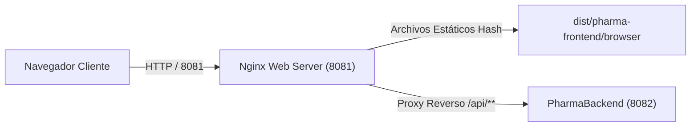

# PharmaFrontend — SPA de PharmaSoft

Aplicación Web de Página Única (SPA) para la gestión de ventas y farmacia desarrollada con Angular 19+ (signals, control flow `@if` / `@for`, `@defer`, standalone components y lazy routing).

---

## 🚀 Despliegue en producción

### 1. Arquitectura de Despliegue y Puertos



| Componente | Rol en Producción | Puerto |
| :--- | :--- | :--- |
| **Nginx Web Server** | Servidor HTTP de estáticos con caché + Proxy reverso | `8081` |
| **PharmaBackend** | Servidor API REST Spring Boot | `8082` |

---

### 2. Variables de Entorno y Configuración
* `src/environments/environment.prod.ts`:
  ```typescript
  export const environment = {
    production: true,
    apiUrl: '/api/v1' // Se enruta por el proxy reverso de Nginx al backend (8082)
  };
  ```

---

### 3. Procedimiento de Construcción y Despliegue

#### A. Construcción del Paquete de Producción
```bash
# Compilar con optimizaciones, minificación y cálculo de estadísticas
npm run build -- --configuration production --stats-json
```
Los artefactos estáticos generados se guardan en `dist/pharma-frontend/browser/` con hashes únicos en sus nombres (`main-[hash].js`, `chunk-[hash].js`, `styles-[hash].css`).

#### B. Despliegue en Servidor Nginx (Docker)
```bash
# Iniciar contenedor Nginx con la configuración de caché
docker compose up -d --build nginx
```

#### C. Procedimiento de Rollback
1. Si un despliegue presenta incidencias en la SPA:
   ```bash
   git checkout HEAD~1
   npm run build -- --configuration production
   docker compose restart nginx
   ```
2. Gracias a la política de versionamiento por hash de archivos y `Cache-Control: no-cache` en `index.html`, los usuarios recibirán de inmediato la versión previa sin necesidad de limpiar la caché del navegador.

---

### 4. Matriz de Buenas Prácticas de Producción

| Buena Práctica | Estado | Detalle y Acción Pendiente |
| :--- | :---: | :--- |
| **Presupuestos de tamaño (`budgets`)** | **Cumple** | Configurado en `angular.json` con advertencias en 500 kB y error en 1 MB. |
| **Carga perezosa (Lazy loading)** | **Cumple** | Todas las features (`ventas`, `productos`, `categorias`, `clientes`) se cargan con `loadChildren`. |
| **Carga diferida (`@defer`)** | **Cumple** | Reporte de más vendidos en `inicio.html` y comprobante de venta en `venta-detalle.html` cargan con `@defer`. |
| **Políticas de caché HTTP (Nginx)** | **Cumple** | `index.html` con `no-cache`, y assets con hash (`*.js`, `*.css`) con `max-age=31536000, immutable`. |
| **Trazabilidad en errores (`requestId`)** | **Cumple** | `mensajeError` extrae el `requestId` y lo muestra en la interfaz para auditoría y soporte. |
| **Seguridad de rutas (Guards)** | **Cumple** | `authGuard` protege rutas privadas y `permisoGuard` valida permisos granulares del token JWT. |

---

### 5. Recomendaciones para los Tres Locales de la Botica
1. **Compresión Brotli / Gzip en Nginx:**
   * Activar `brotli on;` y `gzip on;` en el proxy Nginx para reducir el tamaño de transferencia de los chunks JS en conexiones lentas de sucursales.
2. **Estrategia de Precarga Selectiva (`PreloadAllModules`):**
   * Configurar `withPreloading(PreloadAllModules)` para que los módulos pesados como Ventas se descarguen silenciosamente en segundo plano tras el login, acelerando la atención en caja.
3. **PWA / Service Worker para Modo Offline Básico:**
   * Evaluar la implementación de `@angular/service-worker` para que la aplicación cargue incluso ante caídas momentáneas de conectividad en los locales.
