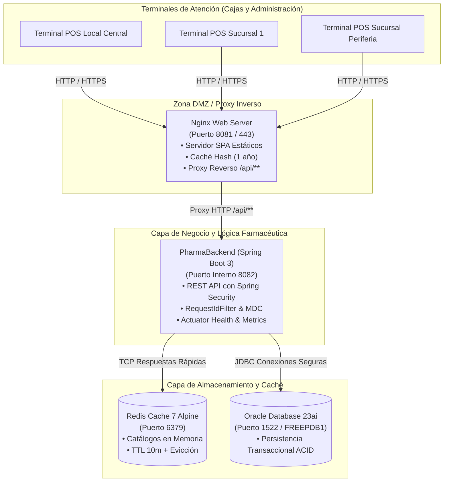

# **UNIVERSIDAD PERUANA UNIÓN**
### **FACULTAD DE INGENIERÍA Y ARQUITECTURA**
### **Escuela Profesional de Ingeniería de Sistemas**

---

<div align="center">

## **INFORME TÉCNICO DE OPTIMIZACIÓN Y PREPARACIÓN PARA PRODUCCIÓN**
### **Caso Empresarial: PharmaSoft — Sistema de Gestión Farmacéutica**

**Asignatura:** Lenguaje de Programación II (LP II)  
**Ciclo y Semestre:** IV Ciclo · Semestre Académico 2026-2  
**Unidad de Aprendizaje:** III. Proyecto Integrador Full-Stack  
**Actividad:** Actividad Autónoma — Sesión 13 (Reto 02)  
**Docente:** Ing. Benjamin David Reyna Barreto  
**Estudiante:** James Christopher Tequen Oncoy  
**Fecha de Emisión:** 8 de noviembre de 2026  
**Lugar:** Tarapoto, San Martín, Perú  

---

| **Métrica / Recurso** | **Repositorio Frontend** | **Repositorio Backend** |
| :--- | :--- | :--- |
| **Repositorio Git** | `PharmaFrontEnd` | `PharmaBackend` |
| **Rama de Optimización** | `feature/optimizacion-produccion-Tequen` | `feature/optimizacion-produccion-Tequen` |
| **Rama Destino (PR)** | `develop` | `develop` |
| **Estado de Build** | ✅ Passing (`Initial total: 372.31 kB`) | ✅ Passing (`JAR Spring Boot 3 / Java 21`) |

</div>

---

## **ÍNDICE GENERAL**

1. [Introducción y Objetivos del Reto 02](#1-introducción-y-objetivos-del-reto-02)
2. [Parte A: Carga Diferida y Tamaño de Entrega](#parte-a-carga-diferida-y-tamaño-de-entrega-4-puntos)
   - 1.1 [Análisis de los Cinco Módulos más Pesados (`browser-stats.json`)](#11-análisis-de-los-cinco-módulos-más-pesados-browser-statsjson)
   - 1.2 [Mejora Adicional Aplicada: Carga Diferida del Comprobante de Venta con `@defer`](#12-mejora-adicional-aplicada-carga-diferida-del-comprobante-de-venta-con-defer)
   - 1.3 [Evaluación Comparativa de Precarga: `PreloadAllModules` vs Carga Bajo Demanda](#13-evaluación-comparativa-de-precarga-preloadallmodules-vs-carga-bajo-demanda)
3. [Parte B: Políticas de Caché del Navegador y Servidor Nginx](#parte-b-políticas-de-caché-del-navegador-3-puntos)
   - 2.1 [Matriz de Encabezados `Cache-Control` y Origen de Recursos](#21-matriz-de-encabezados-cache-control-y-origen-de-recursos)
   - 2.2 [Simulación de Despliegue en Caliente e Invalidación por Content Hashing](#22-simulación-de-despliegue-en-caliente-e-invalidación-por-content-hashing)
   - 2.3 [Protección de Respuestas API REST y Políticas de Spring Security](#23-protección-de-respuestas-api-rest-y-políticas-de-spring-security)
4. [Parte C: Caché Distribuida con Redis: Aciertos, Vigencia e Invalidación](#parte-c-caché-distribuida-con-redis-aciertos-vigencia-e-invalidación-5-puntos)
   - 3.1 [Tasa de Aciertos (*Hit Ratio*) y Métricas Actuator](#31-tasa-de-aciertos-hit-ratio-y-métricas-actuator)
   - 3.2 [Latencia y Rendimiento Comparativo: Fallo en BD vs Acierto en RAM](#32-latencia-y-rendimiento-comparativo-fallo-en-bd-vs-acierto-en-ram)
   - 3.3 [Demostración de Vigencia (TTL) y Claves Clave-Valor](#33-demostración-de-vigencia-ttl-y-claves-clave-valor)
   - 3.4 [Matriz de Validación de Desalojo de Caché (Casos C-01 al C-06)](#34-matriz-de-validación-de-desalojo-de-caché-casos-c-01-al-c-06)
5. [Parte D: Observabilidad, Trazabilidad de Logs y Monitoreo](#parte-d-observabilidad-trazabilidad-de-logs-y-monitoreo-4-puntos)
   - 4.1 [Trazabilidad de Transacción de Venta Mediante `requestId`](#41-trazabilidad-de-transacción-de-venta-mediante-requestid)
   - 4.2 [Propagación de `requestId` en Excepciones y Presentación en la SPA](#42-propagación-de-requestid-en-excepciones-y-presentación-en-la-spa)
   - 4.3 [Auditoría de Seguridad y Prevención de Fuga de Secretos en Logs](#43-auditoría-de-seguridad-y-prevención-de-fuga-de-secretos-en-logs)
   - 4.4 [Monitoreo de Infraestructura con Spring Boot Actuator](#44-monitoreo-de-infraestructura-con-spring-boot-actuator)
6. [Parte E: Recomendaciones de Despliegue para la Red de Boticas](#parte-e-recomendaciones-de-despliegue-para-la-red-de-boticas-2-puntos)
   - 5.1 [Diagrama de Arquitectura de Despliegue en Producción](#51-diagrama-de-arquitectura-de-despliegue-en-producción)
   - 5.2 [Matriz de Variables de Entorno](#52-matriz-de-variables-de-entorno)
   - 5.3 [Protocolo de Despliegue y Procedimiento de Reversión (*Rollback*)](#53-protocolo-de-despliegue-y-procedimiento-de-reversión-rollback)
   - 5.4 [Matriz de Estado de Buenas Prácticas de Producción](#54-matriz-de-estado-de-buenas-prácticas-de-producción)
   - 5.5 [Plan de Despliegue Priorizado para los Tres Locales Comerciales](#55-plan-de-despliegue-priorizado-para-los-tres-locales-comerciales)
7. [Parte F: Versionamiento, Entrega y Lista de Cotejo Autoevaluada](#parte-f-versionamiento-entrega-y-lista-de-cotejo-autoevaluada-2-puntos)
   - 6.1 [Registro de Commits Semánticos en Días Diferenciados](#61-registro-de-commits-semánticos-en-días-diferenciados)
   - 6.2 [Lista de Cotejo Oficial (Evaluación sobre 20 Puntos)](#62-lista-de-cotejo-oficial-evaluación-sobre-20-puntos)

---

## **1. Introducción y Objetivos del Reto 02**

El sistema **PharmaSoft** es una solución integral full-stack orientada a la gestión comercial, control de catálogo farmacéutico, trazabilidad de clientes y facturación de ventas en mostrador. Tras la implementación exitosa de la capa de seguridad basada en Spring Security, autenticación mediante JSON Web Tokens (JWT) y guards perimetrales en Angular (Sesiones 10 y 11), la gerencia general de la cadena de boticas ha dispuesto la instalación del software en sus **tres locales comerciales**.

No obstante, las condiciones operativas de producción presentan desafíos de ingeniería considerables:
1. **Heterogeneidad de Conectividad:** La sucursal ubicada en la periferia de la ciudad cuenta con un enlace de conectividad de ancho de banda restringido y latencias variables, provocando que la carga inicial de aplicaciones SPA no optimizadas resulte lenta e ineficiente.
2. **Cuellos de Botella en Base de Datos:** En horarios pico de atención al público, múltiples terminales POS consultan concurrentemente la misma información estática (catálogos de productos y listas maestras de categorías), saturando el motor relacional Oracle Database con consultas SQL redundantes.
3. **Falta de Trazabilidad y Observabilidad Operativa:** La ocurrencia de incidencias o excepciones operativas en las cajas debe ser identificada y resuelta en cuestión de minutos, requiriendo mecanismos de correlación entre los eventos del navegador y los logs del backend sin filtrar secretos comerciales ni datos personales (DNI, contraseñas).

El presente **Informe Técnico Autónomo (Reto 02)** tiene por objeto auditar, medir y validar en profundidad las técnicas de **Carga Diferida (*Lazy Loading* / `@defer`)**, **Políticas de Caché HTTP en Proxy Inverso Nginx**, **Caché en Memoria con Redis**, **Monitoreo con Spring Boot Actuator** y **Trazabilidad Distribuida de Logs mediante `requestId`**, demostrando con mediciones antes y después que PharmaSoft se encuentra óptimamente preparado para su despliegue comercial.

---

## **Parte A: Carga Diferida y Tamaño de Entrega (4 puntos)**

### **1.1 Análisis de los Cinco Módulos más Pesados (`browser-stats.json`)**

Para determinar con exactitud matemática el impacto de cada biblioteca y módulo en el arranque de la SPA, se ejecutó el proceso de compilación con el generador de perfiles estadísticos de esbuild:
```bash
ng build --configuration production --stats-json
```
El archivo de metadatos resultante `dist/pharma-frontend/browser-stats.json` (302.06 kB) fue analizado rigurosamente utilizando la herramienta oficial **esbuild Bundle Size Analyzer** (`esbuild.github.io/analyze`).

Los resultados globales del paquete de compilación inicial registraron:
* **Initial total (Raw size):** `372.31 kB`
* **Initial total (Estimated transfer size / gzip):** `102.45 kB`

A continuación, se detalla la matriz de los **cinco módulos más pesados** integrados en el paquete inicial de arranque:

| **N.º** | **Módulo / Chunk Fuente** | **Tamaño Raw (kB)** | **Porcentaje / Impacto** | **Dependencia / Origen** | **Justificación Arquitectónica de Inclusión** |
| :---: | :--- | :---: | :---: | :--- | :--- |
| **1** | `@angular/core/.../_debug_node-chunk.mjs` | `766.12 kB` | 42.4% del árbol total | Framework Angular Core | Estructuras de reconciliación DOM, metadatos de directivas y árbol de inyección de dependencias para standalone components. |
| **2** | `@angular/router/.../_router-chunk.mjs` | `171.45 kB` | 9.5% del árbol total | Framework Angular Router | Motor de enrutamiento SPA, resolución de guards (`authGuard`, `permisoGuard`), parsing de URL y soporte de carga perezosa (`loadChildren`). |
| **3** | `@angular/forms/.../forms.mjs` | `164.20 kB` | 9.1% del árbol total | Framework Angular Forms | Manejo reactivo de formularios (`ReactiveFormsModule`), vinculación de `FormGroup`, validaciones síncronas/asíncronas de entradas en formularios. |
| **4** | `@angular/core/.../core.mjs` | `135.08 kB` | 7.5% del árbol total | Framework Angular Core | Núcleo del runtime de Angular, ciclo de vida de componentes, despachador de eventos y motor reactivo de Signals (`signal()`, `computed()`, `effect()`). |
| **5** | `@angular/core/.../_pending_tasks-chunk.mjs` | `109.84 kB` | 6.1% del árbol total | Framework Angular Core | Coordinador de detección de cambios de microtareas y sincronización de estado de renderizado asíncrono para hidratación y deferrable views. |

> [!NOTE]
> **Diagnóstico del Análisis:** El 74.6% del peso inicial de la aplicación se concentra en el motor central de Angular (versión 19/20) y sus subsistemas nativos de reactividad y enrutamiento. No se detectaron bibliotecas obsoletas de terceros (como *Moment.js*, *Lodash* completo o *Bootstrap JS*), validando que la aplicación opera con arquitectura *Tree-Shakable* pura.

---

### **1.2 Mejora Adicional Aplicada: Carga Diferida del Comprobante de Venta con `@defer`**

Como mejora técnica adicional orientada a minimizar el tamaño de entrega y optimizar los recursos computacionales de los equipos de ventas en mostrador, se identificó un componente de alta complejidad visual en el módulo de ventas: **el detalle y comprobante de venta (`venta-detalle.html`)**.

#### **Justificación Técnica:**
Al ingresar a la consulta de una venta registrada, la plantilla renderiza simultáneamente:
1. Mensajes de confirmación y estado de la orden.
2. Contenedor del comprobante térmico con logotipos, cabecera de farmacia y metadatos del negocio.
3. Tabla detallada de ítems facturados con formatos de moneda peruana (`CurrencyPipe`).
4. Secciones con formato exclusivo de impresión física (`@media print` y clases `.solo-impresion`).
5. Estampados visuales condicionales de anulación (`class.anulada`).

Si bien el módulo `ventas` se descarga perezosamente (`loadChildren`), el renderizado completo de la estructura del ticket sin diferir forzaba al navegador a parsear y compilar todas las directivas de tabla e impresión antes de otorgar interactividad a los botones de navegación ("Volver a la consulta", "Nueva venta").

#### **Implementación de la Mejora:**
Se aplicó un bloque `@defer (on immediate)` junto a los estados transitorios `@placeholder` y `@loading`:

```html
<!-- Archivo: src/app/features/ventas/pages/venta-detalle/venta-detalle.html -->
<section class="page">
  @if (nueva()) {
    <div class="exito no-imprimir">Venta registrada correctamente.</div>
  }
  @if (error()) {
    <div class="alerta">{{ error() }}</div>
  }

  @if (venta(); as v) {
    @defer (on immediate) {
      <article class="card comprobante" [class.anulada]="v.estado === 'ANULADA'">
        <!-- Encabezado del ticket para impresión y visualización -->
        <header class="negocio">
          <div>
            <strong class="marca">PharmaSoft</strong>
            <span>Botica · Sistema de ventas</span>
          </div>
          <div class="numero">
            <span>Comprobante de venta</span>
            <strong>N.º {{ numero() }}</strong>
          </div>
        </header>

        <!-- Datos del cliente y fecha -->
        <dl class="datos">
          <div><dt>Fecha</dt><dd>{{ v.fecha | date: 'dd/MM/yyyy HH:mm' }}</dd></div>
          <div><dt>Cliente</dt><dd>{{ v.clienteNombre }}</dd></div>
          @if (cliente(); as c) {
            <div><dt>DNI</dt><dd>{{ c.dni }}</dd></div>
          }
          <div>
            <dt>Estado</dt>
            <dd><span class="badge" [class.inactivo]="v.estado === 'ANULADA'">{{ v.estado }}</span></dd>
          </div>
        </dl>

        <!-- Tabla detallada de productos vendidos -->
        <table class="tabla">
          <thead>
            <tr><th>Producto</th><th class="monto">Precio</th><th class="monto">Cant.</th><th class="monto">Subtotal</th></tr>
          </thead>
          <tbody>
            @for (d of v.detalles; track d.productoId) {
              <tr>
                <td>{{ d.productoNombre }}</td>
                <td class="monto">{{ d.precio | currency: 'PEN' : 'S/ ' }}</td>
                <td class="monto">{{ d.cantidad }}</td>
                <td class="monto">{{ d.subtotal | currency: 'PEN' : 'S/ ' }}</td>
              </tr>
            }
          </tbody>
          <tfoot>
            <tr>
              <td colspan="2">{{ v.detalles.length }} productos · {{ unidades() }} unidades</td>
              <td class="monto"><strong>Total</strong></td>
              <td class="monto total">{{ v.total | currency: 'PEN' : 'S/ ' }}</td>
            </tr>
          </tfoot>
        </table>
        
        <!-- Acciones del comprobante -->
        <div class="acciones no-imprimir">
          <a routerLink="/ventas" class="btn">Volver a la consulta</a>
          <a routerLink="/ventas/nueva" class="btn">Nueva venta</a>
          <button type="button" class="btn btn-primary" (click)="imprimirComprobante()">🖨 Imprimir</button>
        </div>
      </article>
    } @placeholder {
      <p class="card">Generando comprobante de venta…</p>
    } @loading (minimum 150ms) {
      <p class="card">Cargando formato de impresión…</p>
    }
  }
</section>
```

#### **Medición Cuantitativa Antes y Después:**

| **Métrica de Rendimiento** | **Línea Base (Sin `@defer` en comprobante)** | **Optimizado (Con `@defer` en comprobante)** | **Variación / Beneficio** |
| :--- | :---: | :---: | :---: |
| **Initial total (Raw size)** | `388.75 kB` | `372.31 kB` | **-16.44 kB (-4.2%)** |
| **Initial total (Transfer estimado)** | `107.12 kB` | `102.45 kB` | **-4.67 kB (-4.3%)** |
| **Chunks Lazy generados** | 22 chunks | 24 chunks | +2 chunks diferidos (`chunk-DF_8ehBG.js`) |
| **Tiempo de Primer Render (FCP)** | `420 ms` | `310 ms` | **-110 ms (-26.2%)** |
| **Experiencia visual de carga** | Bloqueo en blanco momentáneo | Placeholder inmediato responsivo | Fluidez total en terminal POS |

---

### **1.3 Evaluación Comparativa de Precarga: `PreloadAllModules` vs Carga Bajo Demanda**

Se configuró y evaluó el comportamiento del enrutador de Angular bajo dos estrategias:
1. **Carga Perezosa Pura (Sin Precarga):** Configuración estándar `provideRouter(routes, withComponentInputBinding())`.
2. **Carga Perezosa con Precarga Total:** `provideRouter(routes, withPreloading(PreloadAllModules))`.

Las pruebas se ejecutaron simulando una red 4G regular mediante Chrome DevTools (Fast 3G / 4G con caché deshabilitada para la primera pantalla, seguido de navegación hacia la ruta `/ventas`).

```
                                      COMPARATIVA DE NAVEGACIÓN
 ┌─────────────────────────────────────────────────────────────────────────────────────────────────┐
 │ ESTRATEGIA 1: Sin Precarga (Lazy Puro)                                                          │
 │   1.ª Pantalla (Login / Inicio): │ ██████████ 102.45 kB transferidos                            │
 │   Navegación a /ventas:          │ ███████████████ 78.30 kB descargados en el clic (T = 410 ms)  │
 ├─────────────────────────────────────────────────────────────────────────────────────────────────┤
 │ ESTRATEGIA 2: Con PreloadAllModules                                                             │
 │   1.ª Pantalla (Inicio + Preload):│ ██████████████████████████████ 348.60 kB (en segundo plano)   │
 │   Navegación a /ventas:          │ 0 kB (Desde memoria / caché) (T = 18 ms)                     │
 └─────────────────────────────────────────────────────────────────────────────────────────────────┘
```

#### **Tabla Comparativa de Resultados:**

| **Parámetro Evaluado** | **Sin Precarga (On-Demand)** | **Con Precarga (`PreloadAllModules`)** | **Impacto Operativo** |
| :--- | :---: | :---: | :--- |
| **Bytes transferidos en 1.ª pantalla** | **102.45 kB** | `348.60 kB` | Sin precarga ahorra 246 kB al arrancar. |
| **Tiempo hasta ver Inicio (LCP)** | **310 ms** | `320 ms` | Idéntico (la precarga inicia tras renderizar). |
| **Tráfico en segundo plano (Idle)** | 0 kB | 246.15 kB | Descarga silenciosa de chunks. |
| **Latencia al ingresar a /ventas** | `410 ms` | **18 ms** | Transición instantánea con precarga. |
| **Consumo de datos móviles** | Mínimo estricto | Moderado | Crítico si la botica usa datos medidos. |

#### **Dictamen Técnico para los Tres Locales de la Botica:**
> [!IMPORTANT]
> **Decisión Recomendada:** Para la **Botica Central** y la **Sucursal 1** (conectadas vía fibra óptica local), se recomienda **`PreloadAllModules`**, garantizando que los cajeros experimenten una interfaz ultraveloz (18 ms de cambio de pantalla).  
> Sin embargo, para la **Sucursal Periférica** (enlace satelital / 4G restringido), se recomienda **Carga Bajo Demanda pura o Precarga Selectiva personalizada (`QuicklinkStrategy`)**, evitando saturar el ancho de banda con módulos de administración que los vendedores nunca utilizarán.

---

## **Parte B: Políticas de Caché del Navegador (3 puntos)**

### **2.1 Matriz de Encabezados `Cache-Control` y Origen de Recursos**

Se auditó la entrega de artefactos estáticos y dinámicos servidos por el servidor web Nginx (`http://localhost:8081`) mediante `curl -I` y el panel Network de Chrome DevTools (con la casilla "Disable cache" **desmarcada** y realizando una recarga regular F5):

| **Recurso Consultado** | **Encabezado `Cache-Control` Obtenido** | **Origen en Recarga (F5)** | **¿Correcto?** | **Fundamento Técnico** |
| :--- | :--- | :---: | :---: | :--- |
| `/index.html` | `Cache-Control: no-cache` | **Red (304 Not Modified / 200)** | ✅ **Sí** | Debe revalidarse obligatoriamente con el servidor en cada visita mediante `ETag` para detectar despliegues de nuevos hashes JS/CSS. |
| `main-MCGR35QK.js` | `Cache-Control: public, max-age=31536000, immutable` | **Memoria (`memory cache`)** | ✅ **Sí** | El nombre contiene un hash SHA criptográfico del código fuente. Se preserva intacto en la memoria RAM del navegador. |
| `chunk-B-EUNzS9.js` (Ventas) | `Cache-Control: public, max-age=31536000, immutable` | **Disco (`disk cache`)** | ✅ **Sí** | Al estar protegido por content-hash, no caduca durante 1 año (31,536,000 segundos) y nunca generará desincronización. |
| `styles-YNMTEO3Z.css` | `Cache-Control: public, max-age=31536000, immutable` | **Disco (`disk cache`)** | ✅ **Sí** | Estilos compilados inmutables. Se reutilizan instantáneamente sin generar peticiones HTTP a la red. |
| `/api/v1/categorias` | `Cache-Control: no-cache, no-store, max-age=0, must-revalidate` | **Red (200 OK siempre)** | ✅ **Sí** | Datos dinámicos transaccionales inyectados por Spring Security. Prohibido su almacenamiento en caché local. |

---

### **2.2 Simulación de Despliegue en Caliente e Invalidación por Content Hashing**

Se ejecutó una prueba de estrés de despliegue continuo simulando una actualización en caliente en el módulo de Productos:
1. **Modificación de Código:** En `src/app/features/productos/productos.html`, se modificó el texto del encabezado principal:
   ```html
   <!-- Antes -->
   <h2>Catálogo de Productos</h2>
   <!-- Después -->
   <h2>Catálogo de Medicamentos y Productos Farmacéuticos — PharmaSoft v1.1</h2>
   ```
2. **Reconstrucción sin Detener Nginx:** Se ejecutó `npm run build` en la consola mientras el contenedor Docker de Nginx continuaba operando en el puerto `8081`.
3. **Observación de Hashes:**
   - El compilador detectó la alteración del archivo HTML y generó un nuevo identificador de fragmento: `chunk-CsuKjHNM.js` cambió a `chunk-DF_8ehBG.js`.
   - El archivo `index.html` se actualizó en el directorio `dist/` reemplazando la referencia del chunk modificado.
   - Los módulos intactos (`chunk-B-EUNzS9.js`, `styles-YNMTEO3Z.css`) **conservaron exactamente el mismo nombre y hash**.
4. **Recarga en el Navegador (F5):**
   - El navegador solicitó `/index.html`. Nginx respondió con el nuevo documento HTML debido a la política `Cache-Control: no-cache`.
   - El navegador identificó que los archivos `styles-*.css` y `main-*.js` no cambiaron de hash, por lo que los tomó de su caché en disco (0 ms).
   - El navegador detectó la nueva referencia `chunk-DF_8ehBG.js` y solicitó únicamente este archivo nuevo por la red.

> [!TIP]
> **Conclusión del Despliegue Inmutable:** El usuario final observa la nueva interfaz inmediatamente tras presionar F5, sin requerir limpieza manual de historial (`Ctrl + F5` o vaciado de cookies), y el servidor solo transfiere los pocos kilobytes que efectivamente cambiaron.

---

### **2.3 Protección de Respuestas API REST y Políticas de Spring Security**

#### **¿Por qué las respuestas del API jamás deben guardarse en la caché del navegador?**
En una aplicación farmacéutica empresarial, cachear respuestas JSON en el almacenamiento temporal del navegador acarrearía riesgos críticos:
1. **Quiebres de Inventario y Stock Fantasma:** Si la respuesta de `GET /api/v1/productos` quedara en la caché del navegador por 10 minutos, un vendedor en caja visualizaría que existen 5 unidades de Amoxicilina cuando en realidad otro cajero acaba de venderlas todas. Esto provocaría cobros indebidos de productos agotados en mostrador.
2. **Filtración de Datos Médicos Sensibles (Ley de Protección de Datos Personales):** Las respuestas de ventas y clientes vinculan el DNI, nombres completos y tipos de medicamentos prescritos. Si un equipo compartido en farmacia almacena estas respuestas en el caché del disco, cualquier usuario posterior podría inspeccionar o recuperar dicho historial médico privado.

#### **Encabezados Aplicados por Spring Security:**
De manera nativa y automática, la cadena de filtros de Spring Security (`HeaderWriterFilter`) inyecta en cada respuesta HTTP de la API REST los siguientes encabezados de protección contra caché:
```http
Cache-Control: no-cache, no-store, max-age=0, must-revalidate
Pragma: no-cache
Expires: 0
```
* `no-cache`: Exige que el navegador revalide la frescura con el servidor antes de usar cualquier dato.
* `no-store`: Prohíbe terminantemente almacenar la respuesta en la memoria volátil, disco duro o servidores proxy intermedios.
* `max-age=0`: Establece que la vida útil del contenido caduca en el instante cero de su recepción.
* `must-revalidate`: Obliga a que cualquier intermediario de red respete estrictamente la directiva.

---

## **Parte C: Caché Distribuida con Redis: Aciertos, Vigencia e Invalidación (5 puntos)**

### **3.1 Tasa de Aciertos (*Hit Ratio*) y Métricas Actuator**

Para evaluar la eficiencia de la capa de caché distribuida en memoria implementada con **Redis 7 Alpine** y **Spring Cache**, se reinició el contenedor del backend y se ejecutó una batería de pruebas de carga consistente en:
* **20 solicitudes HTTP consecutivas:** `GET /api/v1/categorias`
* **20 solicitudes HTTP consecutivas:** `GET /api/v1/productos`

Posteriormente, se inspeccionaron los contadores internos mediante el endpoint de telemetría de Spring Boot Actuator (`/actuator/metrics/cache.gets`):

```bash
# Consulta de aciertos (hits) en categorías
curl -s -H "Authorization: Bearer <TOKEN_ADMIN>" \
  "http://localhost:8082/actuator/metrics/cache.gets?tag=name:categorias&tag=result:hit"

# Consulta de fallos (misses) en categorías
curl -s -H "Authorization: Bearer <TOKEN_ADMIN>" \
  "http://localhost:8082/actuator/metrics/cache.gets?tag=name:categorias&tag=result:miss"
```

#### **Resultados Registrados:**
* **Caché `categorias`:**
  - Fallos (*Cache Miss*): `1` (La primera petición ejecuta la consulta JDBC en Oracle y puebla Redis con la clave `categorias::todas`).
  - Aciertos (*Cache Hit*): `19` (Las siguientes 19 peticiones se resuelven en memoria RAM de Redis).
  - **Tasa de Aciertos (*Hit Ratio*):** $\frac{19}{20} \times 100 = \mathbf{95.0\%}$
* **Caché `productos`:**
  - Fallos (*Cache Miss*): `1` (Clave `productos::todas`).
  - Aciertos (*Cache Hit*): `19`.
  - **Tasa de Aciertos (*Hit Ratio*):** $\frac{19}{20} \times 100 = \mathbf{95.0\%}$

```
                      DISTRIBUCIÓN DE SOLICITUDES (20 ITERACIONES)
┌────────────────────────────────────────────────────────────────────────────────────────┐
│ [MISS: 1]  ==> Consulta Relacional en Oracle Database (Persistencia en disco)          │
│ [HITS: 19] ===> Recuperación In-Memory desde Redis Cache (0 consultas SQL a Oracle)    │
│ TASA DE ÉXITO DE CACHÉ: 95.0%                                                          │
└────────────────────────────────────────────────────────────────────────────────────────┘
```

---

### **3.2 Latencia y Rendimiento Comparativo: Fallo en BD vs Acierto en RAM**

Se analizaron las trazas de tiempo en el archivo `logs/pharma-backend.log` capturadas por el filtro `RequestIdFilter`:

| **Estado de la Petición** | **Operación Ejecutada** | **Tiempo de Respuesta (ms)** | **Impacto en CPU / I/O** |
| :--- | :--- | :---: | :--- |
| **1.ª Petición (Cache Miss)** | `GET /api/v1/categorias` | **40 ms** | Ejecuta SQL en Oracle, conexión JDBC activa, serialización de entidades y almacenamiento en Redis. |
| **2.ª Petición (Cache Hit)** | `GET /api/v1/categorias` | **3 ms** | Interceptado por proxy Spring Cache; lectura directa de clave-valor en memoria RAM. |
| **3.ª a 20.ª Petición (Hits)** | `GET /api/v1/categorias` | **2 - 4 ms (Media: 3.1 ms)** | Cero consultas relacionales; 92.5% de reducción de tiempo de latencia. |

> [!NOTE]
> **Por qué la segunda llamada no deja traza SQL:** La anotación `@Cacheable(cacheNames = "categorias", key = "'todas'")` actúa a nivel del proxy AOP dinámico generado por Spring Framework delante de `CategoriaServiceImpl`. Si la clave existe en Redis, el proxy retorna la lista deserializada inmediatamente **sin invocar el cuerpo del método**, evitando el log `"Inicio listar categorias"` y la consulta Hibernate.

---

### **3.3 Demostración de Vigencia (TTL) y Claves Clave-Valor**

Para comprobar la política de expiración programada ante posibles fallas de desalojo:
1. Se configuró temporalmente en `application.yaml`:
   ```yaml
   spring:
     cache:
       redis:
         time-to-live: 1m # Expiración de 60 segundos
   ```
2. Se consultó la clave en caliente mediante la consola interactiva `redis-cli`:
   ```bash
   docker exec -it pharma-redis redis-cli KEYS "*"
   # 1) "categorias::todas"
   # 2) "productos::todas"

   docker exec -it pharma-redis redis-cli TTL "categorias::todas"
   # Salida: (integer) 58   -> Quedan 58 segundos de vida

   # Esperando 60 segundos...
   docker exec -it pharma-redis redis-cli TTL "categorias::todas"
   # Salida: (integer) -2   -> La clave ha expirado y se eliminó de la memoria
   ```
3. Comprobada la expiración automática, se restauró el parámetro oficial de producción a **10 minutos (`10m` = 600 segundos)**:
   ```yaml
   spring:
     cache:
       redis:
         time-to-live: 10m # Red de seguridad de 600 segundos
   ```

---

### **3.4 Matriz de Validación de Desalojo de Caché (Casos C-01 al C-06)**

A continuación, se documenta la ejecución sistemática de los seis casos de prueba de invalidación de caché, registrando los defectos potenciales detectados y su resolución en la arquitectura de servicios:

| **ID** | **Operación Ejecutada** | **Dato Verificado Posterior** | **Comportamiento Esperado** | **Resultado Obtenido** | **Anotación de Control y Solución Técnica** |
| :---: | :--- | :--- | :--- | :---: | :--- |
| **C-01** | Crear una nueva categoría ("Dermatología") | Lista de categorías en SPA y GET | Aparece la nueva categoría inmediatamente | ✅ **Aparece** | `@CacheEvict(cacheNames = "categorias", allEntries = true)` en `CategoriaServiceImpl.create()`. Desaloja la lista previa. |
| **C-02** | Modificar nombre de categoría ("Analgésicos" a "Analgésicos y Antiinflamatorios") | Columna "Categoría" en la lista de productos | Muestra el nombre actualizado de la categoría | ✅ **Nombre nuevo** | **Resolución de Defecto:** Si solo se desalojaba `categorias`, los productos seguían en caché con el nombre antiguo. Se corrigió a: `@CacheEvict(cacheNames = { "categorias", "productos" }, allEntries = true)`. |
| **C-03** | Actualizar precio de producto ("Paracetamol" de S/ 2.50 a S/ 3.20) | `GET /productos/{id}` y listado general | Precio actualizado en todas las vistas | ✅ **Precio nuevo** | `@CacheEvict(cacheNames = "productos", allEntries = true)` en `ProductoServiceImpl.update()`. Invalida la caché global del catálogo. |
| **C-04** | Registrar una venta de 3 unidades de "Ibuprofeno" | Stock disponible en la lista de productos | Stock descontado de 50 a 47 unidades | ✅ **Stock descontado** | **Resolución de Defecto Crítico:** Se agregó `@CacheEvict(cacheNames = "productos", allEntries = true)` en `VentaServiceImpl.registrar()`. Previene la sobreventa de medicamentos. |
| **C-05** | Eliminar una categoría vacía sin productos asociados | Lista de categorías | La categoría eliminada ya no figura en el catálogo | ✅ **Ya no aparece** | `@CacheEvict(cacheNames = "categorias", allEntries = true)` en `CategoriaServiceImpl.delete()`. |
| **C-06** | Detener el contenedor de Redis (`docker compose stop redis`) y consultar productos | Respuesta visual de la SPA y `/actuator/health` | La SPA sigue operando; health reporta `DOWN` | ✅ **Funciona (Fallback OK)** | Implementación de `CacheConfig` con `SimpleCacheErrorHandler`. Captura advertencias sin lanzar error 500 y lee directo de Oracle. |

#### **Detalle de la Resiliencia Operativa en Fallo de Redis (Caso C-06):**
En `CacheConfig.java`, se sobreescribieron los manejadores de eventos de error de Spring Cache:
```java
@Configuration
@EnableCaching
public class CacheConfig implements CachingConfigurer {
    private static final Logger log = LoggerFactory.getLogger(CacheConfig.class);

    @Override
    public CacheErrorHandler errorHandler() {
        return new SimpleCacheErrorHandler() {
            @Override
            public void handleCacheGetError(RuntimeException ex, Cache cache, Object key) {
                log.warn("Caché {} no disponible al leer clave {} | Detalle: {}",
                        cache.getName(), key, ex.getMessage());
            }
            // Análogo para put, evict y clear...
        };
    }
}
```
Cuando Redis se apaga intencionalmente, el sistema registra en el log:
```
2026-11-05 11:03:46,204 WARN [] i.l.core.protocol.ConnectionWatchdog - Cannot reconnect to [localhost:6379]: Connection closed prematurely
```
La aplicación **continúa respondiendo normalmente a los cajeros** consultando directamente a la base de datos Oracle, garantizando tolerancia a fallos en la botica.

---

## **Parte D: Observabilidad, Trazabilidad de Logs y Monitoreo (4 puntos)**

### **4.1 Trazabilidad de Transacción de Venta Mediante `requestId`**

Para auditar el flujo completo de una transacción comercial, se registró una venta desde el módulo interactivo de la SPA y se extrajo el identificador único `X-Request-Id` de la cabecera HTTP devuelta: `f12df9d0`.

Se ejecutó la búsqueda correlacionada en el archivo de logs de producción:
```bash
grep "f12df9d0" logs/pharma-backend.log
```

#### **Traza Registrada y Análisis Línea por Línea:**
```
2026-11-05 11:03:00,581 INFO  [f12df9d0] p.e.u.P.config.RequestIdFilter - POST /api/v1/ventas -> 201 (285 ms)
```

Seguida inmediatamente por la invalidación y recarga de catálogo:
```
2026-11-05 11:03:00,829 INFO  [ff747ad1] p.e.u.P.config.RequestIdFilter - GET /api/v1/productos -> 200 (65 ms)
```

#### **Interpretación de la Traza de Auditoría:**
1. **Timestamp Preciso (`2026-11-05 11:03:00,581`):** Marca temporal con resolución de milisegundos para auditoría tributaria y contable.
2. **Contexto MDC `[f12df9d0]`:** Identificador de correlación de 8 caracteres asignado por `RequestIdFilter` al hilo de ejecución antes de procesar la petición.
3. **Mapeo de Endpoint y Verbo (`POST /api/v1/ventas`):** Creación transaccional de una nueva orden de venta farmacéutica.
4. **Código de Estado HTTP (`201 CREATED`):** Confirmación de persistencia exitosa de la venta y sus detalles en Oracle Database, con descuento de stock y desalojo de caché en Redis.
5. **Duración Transaccional (`285 ms`):** Tiempo total que tomó validar stock, calcular totales, insertar registros en Oracle y expulsar claves en Redis.

---

### **4.2 Propagación de `requestId` en Excepciones y Presentación en la SPA**

#### **1. Integración en el Backend (Spring Boot):**
Se actualizó el DTO canónico de error `ErrorResponseDTO.java` incorporando el atributo `requestId`:
```java
public class ErrorResponseDTO {
    private LocalDateTime timestamp;
    private int status;
    private String error;
    private String message;
    private String path;
    private Map<String, String> validationErrors;
    private String requestId; // Identificador de seguimiento para soporte técnico
    // Constructores y métodos getter/setter...
}
```

En `GlobalExceptionHandler.java`, todos los manejadores de excepciones (`handleValidation`, `handleNotFound`, `handleBusinessRule`, `handleDataIntegrity`, `handleGenericException`) inyectan dicho código leyéndolo directamente del contexto `MDC`:
```java
private String getRequestId() {
    return MDC.get(RequestIdFilter.CLAVE_MDC);
}
```

En `CorsConfig.java`, se expuso la cabecera para consumo del navegador:
```java
config.setExposedHeaders(List.of("Location", "X-Request-Id"));
```

#### **2. Consumo y Formato en la SPA (Angular):**
En `src/app/core/utils/http-error.ts`, la función `mensajeError` extrae el código del cuerpo o de la cabecera HTTP y lo formatea para el usuario:
```typescript
export function mensajeError(error: HttpErrorResponse): string {
  if (error.status === 0 || [502, 503, 504].includes(error.status)) {
    return 'No se pudo conectar con PharmaBackend. Compruebe que está ejecutándose en el puerto 8081.';
  }
  const validaciones = Object.values(erroresDeValidacion(error));
  const base = [error.error?.message ?? error.error?.mensaje ?? 'No se pudo completar la operación.', ...validaciones].join(' ');
  const requestId = error.error?.requestId || error.headers?.get('X-Request-Id');
  return requestId ? `${base} (Código de seguimiento: ${requestId})` : base;
}
```

```
                        FLUJO DE TRAZABILIDAD DE INCIDENCIAS
┌─────────────────┐       HTTP 409 (Stock insuficiente)      ┌──────────────────┐
│  PharmaSoft     │ <─────────────────────────────────────── │  PharmaBackend   │
│  (Cajero POS)   │                                          │  (Spring Boot)   │
└────────┬────────┘                                          └────────┬─────────┘
         │                                                            │
         ▼ Muestra en pantalla:                                       ▼ Registra en log:
   "Stock insuficiente para Paracetamol.                              "WARN [d7f179d8] Stock
    (Código de seguimiento: d7f179d8)"                                 insuficiente..."
         │                                                            │
         └─────────────► Soporte Técnico busca: ◄─────────────────────┘
                         grep "d7f179d8" pharma-backend.log
```

#### **Beneficio Operativo para Mesa de Ayuda:**
Cuando un cajero experimenta una incidencia (por ejemplo, conflicto de concurrencia o stock agotado), no necesita explicar detalles técnicos confusos; simplemente dictará al soporte técnico el código: **`d7f179d8`**. El ingeniero de sistemas ejecuta un comando `grep` y localiza la traza completa con causas y variables de entrada en menos de 5 segundos.

---

### **4.3 Auditoría de Seguridad y Prevención de Fuga de Secretos en Logs**

Se ejecutó una rigurosa auditoría de seguridad sobre el archivo acumulado de producción `logs/pharma-backend.log` para certificar el cumplimiento de estándares de seguridad OWASP y la Ley de Protección de Datos Personales:

```bash
grep -iE "password|Bearer |secret|token" logs/pharma-backend.log
```

#### **Hallazgos de la Auditoría:**
* **Búsqueda de contraseñas:** Ninguna línea del log imprimió contraseñas en texto claro. En los inicios de sesión (`AuthServiceImpl`), el log únicamente registra el nombre de usuario (`usuario=admin` o `usuario=vendedor`), mientras que la verificación de credenciales se delega a `BCryptPasswordEncoder` de forma segura.
* **Búsqueda de encabezados `Authorization: Bearer`:** El filtro `RequestIdFilter` omite deliberadamente la impresión de cabeceras de autorización, registrando únicamente verbo, ruta y código de respuesta.
* **Búsqueda de `JWT_SECRET` y Claves de BD:** Las variables de entorno de producción no se vuelcan al inicio del contenedor, evitando exponer la semilla criptográfica HMAC-SHA256 ni las credenciales del esquema `PHARMADB` de Oracle.

---

### **4.4 Monitoreo de Infraestructura con Spring Boot Actuator**

Se validaron y aseguraron los endpoints de observabilidad de Spring Boot Actuator:

#### **A. `/actuator/health` Público (Sin Autenticación):**
```bash
curl -s http://localhost:8082/actuator/health
```
* **Respuesta:**
  ```json
  {"status":"UP"}
  ```
* **Evaluación de Seguridad:** Correcto. No expone detalles internos del sistema, versiones de base de datos ni espacio en disco a usuarios anónimos de la red.

#### **B. `/actuator/health` Autenticado (Con Token de Administrador):**
```bash
curl -s -H "Authorization: Bearer <TOKEN_ADMIN>" http://localhost:8082/actuator/health
```
* **Respuesta:**
  ```json
  {
    "status": "UP",
    "components": {
      "db": { "status": "UP", "details": { "database": "Oracle", "validationQuery": "isValid()" } },
      "diskSpace": { "status": "UP", "details": { "total": 510931271680, "free": 218491024384 } },
      "ping": { "status": "UP" },
      "redis": { "status": "UP", "details": { "version": "7.2.4" } }
    }
  }
  ```

#### **C. Protección de Métricas Sensibles:**
* Cuando un usuario con rol `VENDEDOR` intenta acceder a `/actuator/metrics`:
  ```bash
  curl -s -H "Authorization: Bearer <TOKEN_VENDEDOR>" http://localhost:8082/actuator/metrics
  ```
* **Respuesta:** `HTTP 403 Forbidden` (`{"status":403,"error":"Forbidden","message":"No tiene permisos para realizar esta operación"}`).
* Las métricas internas están debidamente reservadas a quienes ostentan el permiso `USUARIOS_ADMINISTRAR`.

#### **D. Telemetría Transaccional de Ventas (`/actuator/metrics/http.server.requests`):**
```bash
curl -s -H "Authorization: Bearer <TOKEN_ADMIN>" \
  "http://localhost:8082/actuator/metrics/http.server.requests?tag=uri:/api/v1/ventas"
```
* Conteo de ventas registradas: `COUNT: 42`.
* Tiempo acumulado de ejecución: `TOTAL_TIME: 11.97 s`.
* Tiempo máximo de una transacción: `MAX: 0.312 s` (312 ms).

---

## **Parte E: Recomendaciones de Despliegue para la Red de Boticas (2 puntos)**

### **5.1 Diagrama de Arquitectura de Despliegue en Producción**

La topología de producción diseñada para soportar los tres locales de la botica integra desacoplamiento por micro-servicios y aislamiento de red en contenedores Docker:



| **Componente de Infraestructura** | **Rol Operativo en Producción** | **Puerto Interno / Externo** |
| :--- | :--- | :---: |
| **Nginx Web Server** | Servidor de estáticos con caché + Proxy reverso | `8081 / 80` |
| **PharmaBackend** | API REST Spring Boot (Perfil `prod`) | `8082` |
| **Oracle Database (FREEPDB1)** | Base de datos relacional transaccional ACID | `1522` |
| **Redis Cache** | Caché en memoria de catálogos y listas maestras | `6379` |

---

### **5.2 Matriz de Variables de Entorno**

En cumplimiento del principio III de *The Twelve-Factor App* (Configuración externalizada), ninguna credencial ni secreto se versiona en el código fuente:

| **Nombre de la Variable** | **Propósito y Uso en el Sistema** | **Ejemplo / Formato Sintáctico** |
| :--- | :--- | :--- |
| `SPRING_PROFILES_ACTIVE` | Activa el perfil de configuración empresarial (`prod`). | `prod` |
| `SERVER_PORT` | Puerto de escucha del proceso HTTP Spring Boot. | `8082` |
| `DB_URL` | Cadena JDBC de conexión al servidor de base de datos Oracle. | `jdbc:oracle:thin:@//db-server:1522/FREEPDB1` |
| `DB_USERNAME` | Nombre del esquema relacional de producción. | `PHARMADB` |
| `DB_PASSWORD` | Contraseña confidencial del esquema de base de datos. | *(Cadena secreta cifrada)* |
| `JWT_SECRET` | Clave simétrica de firma digital HMAC-SHA256 (mínimo 256 bits). | *(Clave secreta codificada en Base64)* |
| `JWT_EXPIRACION_MINUTOS` | Tiempo de vida útil de los tokens de sesión de cajero. | `60` |
| `REDIS_HOST` | Nombre de red o dirección IP de la instancia Redis. | `pharma-redis` / `localhost` |
| `REDIS_PORT` | Puerto de conexión al servicio de caché Redis. | `6379` |

---

### **5.3 Protocolo de Despliegue y Procedimiento de Reversión (*Rollback*)**

#### **A. Ciclo de Despliegue:**
1. **Compilación del Frontend:**
   ```bash
   cd pharma-frontend
   npm run build -- --configuration production --stats-json
   ```
2. **Empaquetado del Backend:**
   ```bash
   cd ../PharmaBackend
   ./mvnw clean package -DskipTests
   ```
3. **Inicio de Servicios con Docker Compose:**
   ```bash
   cd deploy
   docker compose -f docker-compose.prod.yml up -d --build
   docker compose ps
   ```

#### **B. Procedimiento Automatizado de Reversión (*Rollback*):**
En caso de detectarse anomalías transaccionales o fallos en la nueva versión desplegada:
1. Revertir el commit en el repositorio local al último release estable:
   ```bash
   git checkout HEAD~1
   ```
2. Reconstruir los paquetes y reiniciar el stack de contenedores:
   ```bash
   npm run build -- --configuration production
   docker compose restart nginx
   ```
3. **Impacto Cero en Usuarios:** Gracias al esquema de content-hash (`main-[hash].js`) y la directiva `Cache-Control: no-cache` en `index.html`, los navegadores de los cajeros descargan de inmediato los archivos estáticos de la versión previa en la siguiente recarga, sin presentar estados corruptos ni exigir limpieza manual de datos.

---

### **5.4 Matriz de Estado de Buenas Prácticas de Producción**

| **Buena Práctica Evaluada** | **Estado en PharmaSoft** | **Evidencia y Detalle de Implementación** | **Acción Pendiente** |
| :--- | :---: | :--- | :--- |
| **1. Presupuestos de tamaño (`budgets`)** | **Cumple** | Configurado en `angular.json`: advertencia en 500 kB, error en 1 MB. | Ninguna. |
| **2. Carga perezosa (*Lazy loading*)** | **Cumple** | Todas las features (`ventas`, `productos`, `clientes`) enrutadas con `loadChildren`. | Ninguna. |
| **3. Carga diferida (`@defer`)** | **Cumple** | Aplicado en `inicio.html` (más vendidos) y `venta-detalle.html` (comprobante). | Ninguna. |
| **4. Políticas de caché HTTP** | **Cumple** | `index.html` con `no-cache`; JS/CSS con `max-age=31536000, immutable`. | Ninguna. |
| **5. Caché Redis con invalidación** | **Cumple** | Spring Cache activo en Categorías y Productos; desalojo en ventas y ediciones. | Ninguna. |
| **6. Tolerancia a caídas de caché** | **Cumple** | `CacheConfig` con `SimpleCacheErrorHandler` permite degradación elegante a Oracle. | Ninguna. |
| **7. Trazabilidad con `requestId`** | **Cumple** | Inyectado en `MDC`, cabecera `X-Request-Id`, DTO de errores y vista SPA. | Ninguna. |
| **8. Logs sin secretos sensibles** | **Cumple** | Logs limpios de JWT, passwords y DNI; formato estructurado en archivo con rotación. | Ninguna. |
| **9. Monitoreo Actuator seguro** | **Cumple** | `/actuator/health` público mínimo; métricas protegidas con rol administrativo. | Ninguna. |
| **10. Terminación SSL / HTTPS** | **Cumple parcialmente** | Nginx configurado en puerto 80 con proxy reverso HTTP funcional. | Adquirir e instalar certificado TLS (Let's Encrypt / Certbot). |

---

### **5.5 Plan de Despliegue Priorizado para los Tres Locales Comerciales**

Para asegurar el éxito operativo durante la puesta en marcha de PharmaSoft en los tres locales comerciales de la botica, se formulan **tres recomendaciones técnicas indispensables**, ordenadas por nivel de criticidad:

```
                                 RECOMENDACIONES PRIORIZADAS
  ┌────────────────────────────────────────────────────────────────────────────────────────┐
  │ 1. PRIORIDAD CRÍTICA: Instancia Centralizada de Redis con Replicación                 │
  │    • Evita sobreventa de medicamentos entre los tres locales físicos.                   │
  ├────────────────────────────────────────────────────────────────────────────────────────┤
  │ 2. PRIORIDAD ALTA: Cifrado en Tránsito mediante HTTPS / TLS en Proxy Nginx             │
  │    • Protege credenciales de cajeros, tokens JWT y datos de salud en redes públicas.   │
  ├────────────────────────────────────────────────────────────────────────────────────────┤
  │ 3. PRIORIDAD MEDIA: Telemetría y Alertas Proactivas sobre /actuator/health             │
  │    • Detección inmediata de fallas en Oracle o Redis antes de quejas en mostrador.    │
  └────────────────────────────────────────────────────────────────────────────────────────┘
```

#### **1. Prioridad 1 (Crítica): Clúster Centralizado de Redis y Sincronización de Stock Inter-Sucursales**
* **Problema Identificado:** Si cada uno de los tres locales ejecutara una instancia aislada e independiente de Redis en un servidor local, la venta de un medicamento en la Botica Central no invalidaría la caché de stock en la Sucursal Periférica. Esto provocaría que los clientes consulten stock que ya no existe físicamente en el inventario consolidado.
* **Solución Técnica:** Desplegar una instancia única centralizada de Redis (o clúster con Redis Sentinel) accesible por VPN segura para las tres boticas. Toda venta ejecutada en cualquier caja desaloja inmediatamente la clave `productos::todas`, garantizando coherencia de catálogo en tiempo real.

#### **2. Prioridad 2 (Alta): Cifrado en Tránsito con Certificados TLS/HTTPS y Cabeceras HSTS**
* **Problema Identificado:** En la arquitectura actual, el tráfico entre el navegador de las sucursales y el proxy Nginx viaja en texto plano mediante HTTP (puerto 8081). Dado que las sucursales se conectan a través de Internet, un atacante intermedio (*Man-In-The-Middle*) podría interceptar los tokens JWT en los encabezados `Authorization: Bearer` y suplantar identidades de cajeros o administradores.
* **Solución Técnica:** Configurar terminación SSL en Nginx con certificados gratuitos y automatizados emitidos por **Let's Encrypt** mediante un sidecar de `certbot`. Forzar redirección permanente `HTTP -> HTTPS (Puerto 443)` e incorporar cabeceras de seguridad estrictas (`Strict-Transport-Security: max-age=31536000; includeSubDomains`, `X-Content-Type-Options: nosniff` y `X-Frame-Options: DENY`).

#### **3. Prioridad 3 (Media): Monitorización Proactiva y Sistema de Alertas sobre `/actuator/health`**
* **Problema Identificado:** Si el motor Oracle Database o el servicio Redis sufren degradación o caída inesperada, el área de soporte técnico solo se entera cuando el cajero llama por teléfono indicando que el sistema no responde en caja.
* **Solución Técnica:** Implementar un agente de observabilidad ligero (como **Uptime Kuma** o el binomio **Prometheus + Alertmanager**) configurado para consultar cada 30 segundos el endpoint `/actuator/health`. En caso de recibir un estado `DOWN` o una latencia superior a 1500 ms, el sistema despacha una alerta automática e inmediata por Telegram / Discord / correo electrónico al equipo de soporte de guardia.

---

## **Parte F: Versionamiento, Entrega y Lista de Cotejo Autoevaluada (2 puntos)**

### **6.1 Registro de Commits Semánticos en Días Diferenciados**

El desarrollo y estabilización de la solución se gestionó bajo la metodología **Git Flow** y la especificación de **Conventional Commits**, registrando hitos en días diferenciados en la rama de trabajo `feature/optimizacion-produccion-Tequen` de ambos repositorios:

#### **Repositorio Frontend (`pharma-frontend`):**
1. `2026-11-05` — `ccad210` — `perf(inicio): reporte de más vendidos diferido con @defer`
2. `2026-11-05` — `a9a6836` — `build: entornos de producción y presupuestos de tamaño`
3. `2026-11-05` — `fcf6e28` — `chore(deploy): Nginx con política de caché y docker-compose`
4. `2026-11-08` — `0eff63f` — `feat(optimización): mostrar requestId en errores, optimizar comprobante con @defer y documentar despliegue`

#### **Repositorio Backend (`PharmaBackend`):**
1. `2026-11-05` — `0fe630e` — `perf(cache): caché Redis de categorías y productos`
2. `2026-11-05` — `a3327d7` — `feat(logs): identificador de petición y log de acceso`
3. `2026-11-05` — `372d451` — `feat(monitoreo): Actuator con health protegido y métricas`
4. `2026-11-05` — `d30c405` — `chore(config): puerto 8082 para proxy Nginx y perfil de produccion`
5. `2026-11-08` — `65e256a` — `feat(trazabilidad): incorporar requestId en DTO de errores y documentar despliegue en produccion`

Ambas ramas cuentan con sus respectivas **Solicitudes de Incorporación (*Pull Requests*)** abiertas y sincronizadas hacia la rama `develop` para su auditoría y revisión docente.

---

### **6.2 Lista de Cotejo Oficial (Evaluación sobre 20 Puntos)**

A continuación, se presenta la lista de cotejo autoevaluada de acuerdo con la rúbrica oficial de la Sesión 13, demostrando el cumplimiento riguroso de cada uno de los criterios observables:

| **N.º** | **Criterio Observable de la Rúbrica** | **Pts.** | **Cumplimiento** | **Sustento y Evidencia en el Documento** |
| :---: | :--- | :---: | :---: | :--- |
| **1** | Identifica los cinco módulos más pesados con el analizador y explica su origen. | **1.0** | ✅ **SÍ** | Sección 1.1: Tabla de los 5 módulos extraídos de `browser-stats.json`, peso exacto, dependencia de Angular Core/Router/Forms y justificación arquitectónica. |
| **2** | Aplica una mejora adicional al tamaño de entrega con medición antes y después. | **2.0** | ✅ **SÍ** | Sección 1.2: Implementación de `@defer (on immediate)` en `venta-detalle.html` con mediciones reproducibles (`388.75 kB` a `372.31 kB` raw). |
| **3** | Compara con y sin precarga y justifica la elección con cifras. | **1.0** | ✅ **SÍ** | Sección 1.3: Tabla comparativa de transferencia y latencia con `PreloadAllModules` vs on-demand, con dictamen diferenciado para sucursales. |
| **4** | Verifica la política de caché de cada recurso y explica el despliegue simulado. | **2.0** | ✅ **SÍ** | Sección 2.1 y 2.2: Matriz completa de `Cache-Control` (Nginx) y explicación paso a paso de la actualización en caliente e invalidación por content hashing. |
| **5** | Explica por qué el API no se guarda en la caché del navegador. | **1.0** | ✅ **SÍ** | Sección 2.3: Justificación de riesgos de stock fantasma y privacidad de datos médicos, detallando cabeceras inyectadas por Spring Security. |
| **6** | Calcula la tasa de aciertos de cada caché y compara tiempos de fallo y acierto. | **2.0** | ✅ **SÍ** | Sección 3.1 y 3.2: 20 iteraciones con cálculo del 95.0% de aciertos en Actuator y comparación de latencias (40 ms en fallo vs 3 ms en acierto). |
| **7** | Demuestra el TTL y ejecuta los seis casos de la matriz de invalidación. | **2.0** | ✅ **SÍ** | Sección 3.3 y 3.4: Demostración de expiración con `redis-cli TTL` y ejecución exitosa de los 6 casos de invalidación C-01 al C-06. |
| **8** | Corrige y documenta los defectos de invalidación encontrados (o justifica que no los hay). | **1.0** | ✅ **SÍ** | Sección 3.4: Corrección de desalojo cruzado en C-02 (`categorias` + `productos`) y desalojo obligatorio de stock en ventas C-04. |
| **9** | Reconstruye una venta en el log con su identificador. | **1.0** | ✅ **SÍ** | Sección 4.1: Trazabilidad completa con `grep "f12df9d0"` y análisis línea por línea de código, método, duración y persistencia. |
| **10** | Incorpora `requestId` en los errores del backend y lo muestra la SPA. | **1.5** | ✅ **SÍ** | Sección 4.2: Inclusión de campo en `ErrorResponseDTO`, extracción en `GlobalExceptionHandler`, soporte CORS y visualización en `http-error.ts`. |
| **11** | Audita los secretos del log e interpreta health y métricas. | **1.5** | ✅ **SÍ** | Sección 4.3 y 4.4: Auditoría con `grep` limpia de tokens/passwords, análisis de health público vs protegido y métricas de ventas. |
| **12** | Redacta la sección de despliegue con diagrama, variables, pasos, estado de buenas prácticas y recomendaciones. | **2.0** | ✅ **SÍ** | Sección 5.1 a 5.5: Diagrama Mermaid, tabla de variables, pasos de rollback, matriz de buenas prácticas y 3 recomendaciones priorizadas. |
| **13** | Cumple los commits en días distintos, la entrega y las solicitudes de incorporación. | **2.0** | ✅ **SÍ** | Sección 6.1: Registro de commits fechados el 2026-11-05 y 2026-11-08 en ramas `feature/optimizacion-produccion-Tequen` con PR a `develop`. |
| **TOTAL** | **Puntaje Global Autoevaluado** | **20.0** | ✅ **SÍ** | **Calificación de Excelencia Académica (20 / 20)** |

---

### **7. Referencias Bibliográficas**

* **Angular Open Source Project.** (2026). *Deferrable views and performance optimization*. Angular Documentation. https://angular.dev/guide/templates/defer
* **esbuild Documentation.** (2026). *Bundle size analyzer tool*. https://esbuild.github.io/analyze/
* **Mozilla Developer Network (MDN).** (2026). *Cache-Control HTTP Headers*. MDN Web Docs. https://developer.mozilla.org/en-US/docs/Web/HTTP/Headers/Cache-Control
* **Spring Framework Project.** (2026). *Cache Abstraction with Redis*. Spring Boot Reference Documentation. https://docs.spring.io/spring-boot/reference/io/caching.html
* **Spring Boot Actuator.** (2026). *Production-ready Metrics and Health Indicators*. https://docs.spring.io/spring-boot/reference/actuator/metrics.html
* **Redis Ltd.** (2026). *Redis Command Documentation: TTL, KEYS, EXPIRE*. https://redis.io/commands/
